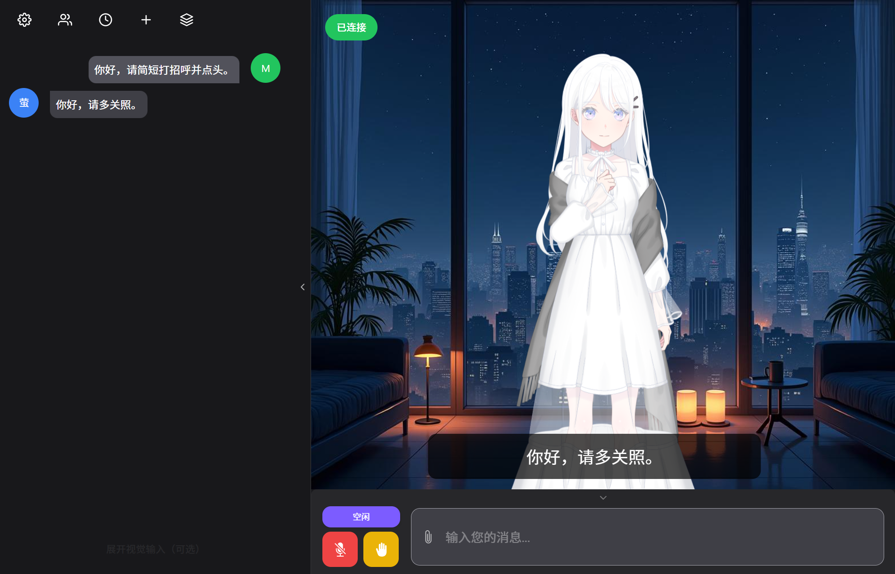

# 萤 AI 对话 · Windows 便携桌面版

基于 **Open-LLM-VTuber** 和 **GPT-SoVITS** 整理、修改的 Live2D 语音对话桌面应用：你说中文，萤使用日语回答，并显示中文字幕，配合表情、动作与口型。

本项目是对现有开源项目和社区素材的集成，不是从零实现的语音引擎、Live2D 引擎或角色模型。感谢上游维护者、贡献者，以及分享模型与声音素材的群友。



## 下载与使用

前往 [Releases](https://github.com/ucas-xuqipeng/hotaru-ai-desktop/releases) 下载 Windows x64 便携版。仓库右上角的 **Code → Download ZIP 只包含源码**，不是完整运行包。

完整运行包随附桌面显示引擎、Python、SenseVoice 中文语音识别、萤 Live2D、GPT-SoVITS v2ProPlus 音色和推理依赖，无需另装浏览器、Python 或 Node.js。AI 对话仍需联网调用你自己的 API。

1. 下载同一版本的全部 `.zip.001`、`.zip.002` 等分卷，以及 `Merge-Parts.cmd`，放在同一个文件夹。
2. 双击 `Merge-Parts.cmd` 合并成 ZIP，再完整解压；也可以使用支持分卷的解压工具打开 `.zip.001`。
3. 编辑解压目录下的 `config/config.yaml`，填写自己的 OpenAI 兼容 API 地址、密钥与模型名称。公开包不包含开发者的私人 API 密钥。
4. 双击 **萤AI对话.exe**，等待本地服务和模型加载。
5. 输入中文，或点击麦克风并授权，听取日语回答并查看中文字幕。

默认模型字符串保留为 `Qwen3.8-Flash-Next-NVFP4`；这是对接服务端使用的模型标识，需由你选择的 API 服务实际支持，也可改为其他支持结构化回复的模型。API 配置示例见 [config/config.example.yaml](config/config.example.yaml)，具体字段在 `character_config.agent_config.llm_configs.openai_compatible_llm` 下。

请复制**整个解压目录**，不能只复制 EXE。设置、历史记录与日志保存在 `data` 中；关闭窗口会清理本次启动的本地服务。首次加载可能需要几分钟，CPU 合成通常更慢。需要强制 CPU 时先关闭应用，再运行 `CPU模式启动.cmd`。

摄像头和屏幕输入默认收起，普通语音对话无需打开。摄像头需要单独授权；屏幕输入需要在原生对话框中选择共享来源。

## 完整人设更新（2026-10-21）

已将使用者提供的 **A_汐见萤.md** 与 **soul.md** 完整合并进默认配置示例，保留第 20 话及视角故事之后的角色状态、礼貌称呼、日常喜好与内在矛盾；继续使用日语配音、中文字幕及表情动作输出。两份原文按原始字节保存在 [人设资料目录](backend/characters/hotaru_persona_materials/)，出处与引用标注均保留。感谢使用者提供资料，以及原作、资料整理者与社区分享者；未提供可核实的整理者署名，不编造作者名称。

**已下载 v1.0.0 完整便携版的用户**：另下载 [Hotaru-Persona-20261021.zip](https://github.com/ucas-xuqipeng/hotaru-ai-desktop/releases/download/v1.0.0/Hotaru-Persona-20261021.zip)，将其中的 `backend` 文件夹合并到 EXE 所在目录，在设置的角色配置列表选择“萤 · 完整人设（第20话之后）”，然后新建对话。这个小更新包继承已有 API、声音及模型配置，不覆盖私人密钥，无需重新下载大分卷。重启后如恢复默认配置，请再次选择此人设。详细步骤见 [人设更新说明](docs/persona-update.md)。v1.0.0 的原始大分卷保持原样，人设更新由此小包提供。

## 本次集成做了什么

- 将现有界面整合到独立的 Electron 桌面窗口，启动时自动加载本地后台和声音服务。
- 在同一结构化回复中生成日语台词、中文字幕、表情与动作，减少独立翻译步骤。
- 修复双语 JSON 返回格式兼容、连接未就绪提示、会话恢复和语音错误处理。
- 为便携包重定位模型路径，动态选择本机端口，支持 GPU / CPU 语音推理。
- 保存跨端口的偏好设置并迁移内置背景地址，默认收起可选视觉工具。
- 限制桌面权限与导航，退出时只停止应用自己启动的进程。

## 模型、音色与特别致谢

**萤的 Live2D 素材和 GPT-SoVITS 音色由群友分享，经本项目使用者提供。** Live2D 素材选自使用者提供的 `OurNotes_v101_Live2D_Full.7z`。感谢提供、制作、整理和分享这些素材的群友及原作者。

目前未提供可核实的原作者姓名或主页，因此这里不编造署名，也不把角色、美术、建模、动作、声音训练成果归为本项目原创。素材的相关权利仍归各自原作者及权利人所有；代码许可证不覆盖这些第三方素材，原素材附带的说明和使用条件继续适用。如需补充准确署名，可提交 Issue 或 PR。

## 参考项目与致谢

| 项目 / 来源 | 本项目使用或参考的部分 |
| --- | --- |
| [Open-LLM-VTuber](https://github.com/Open-LLM-VTuber/Open-LLM-VTuber) | Python 后台、对话链路、ASR/TTS 接口、历史记录与 Live2D 协议，是本项目的主要基础 |
| [Open-LLM-VTuber-Web](https://github.com/Open-LLM-VTuber/Open-LLM-VTuber-Web) | React / Electron 前端、聊天界面、音频播放、口型、模型控制与多语言界面 |
| [GPT-SoVITS](https://github.com/RVC-Boss/GPT-SoVITS) | 日语语音合成、v2ProPlus 推理与预训练资源；感谢 RVC-Boss 和所有贡献者 |
| [Live2D Cubism Web Framework](https://github.com/Live2D/CubismWebFramework) 与 [Cubism SDK for Web](https://www.live2d.com/en/sdk/download/web/) | Live2D 渲染、表情与动作；Core 与 Framework 保留各自条款 |
| [Electron](https://github.com/electron/electron) | 独立桌面窗口、原生权限和进程生命周期；发行包使用官方 44.9.3 win32-x64 运行时 |
| [sherpa-onnx](https://github.com/k2-fsa/sherpa-onnx) 与 [SenseVoice](https://github.com/QwenAudio/SenseVoice) | 中文语音识别及 ONNX 模型推理 |
| [vad-web](https://github.com/ricky0123/vad) 与 [ONNX Runtime](https://github.com/microsoft/onnxruntime) | 语音活动检测与前端推理 |
| [PyTorch](https://github.com/pytorch/pytorch)、[Transformers](https://github.com/huggingface/transformers)、[Python](https://www.python.org/) | 模型推理与本地运行环境 |
| [BigVGAN](https://github.com/NVIDIA/BigVGAN) | GPT-SoVITS 上游包含的声码器相关实现 |
| [pyopenjtalk](https://github.com/r9y9/pyopenjtalk)、[g2pW](https://github.com/GitYCC/g2pW)、[NLTK](https://github.com/nltk/nltk) | GPT-SoVITS 上游使用的文本、发音和语言处理资源 |
| [CjangCjengh/vits](https://github.com/CjangCjengh/vits) | GPT-SoVITS 日语处理文件注明的参考实现，保留其来源注释 |
| [React](https://github.com/facebook/react)、[Vite](https://github.com/vitejs/vite)、[Chakra UI](https://github.com/chakra-ui/chakra-ui)、[i18next](https://github.com/i18next/i18next) | 前端框架、构建、界面与国际化 |
| [FFmpeg](https://ffmpeg.org/) 与 [7-Zip](https://www.7-zip.org/) | 音频处理，以及便携包打包与完整性检查；FFmpeg 的完整许可、报告版本对应的固定源码和构建信息见 [FFmpeg-SOURCE.md](third_party/FFmpeg-SOURCE.md)，源码副本同时随 Release 提供 |
| 提供素材的群友及原作者 | 萤的 Live2D、美术、动作、音色模型和参考语音 |

更完整的依赖版本和项目链接见 [third_party/DEPENDENCIES.json](third_party/DEPENDENCIES.json)，直接 JavaScript 依赖及锁定的间接依赖见 [frontend/package.json](frontend/package.json) 和 [frontend/package-lock.json](frontend/package-lock.json)；Python 项目声明见 [backend/pyproject.toml](backend/pyproject.toml)。感谢这些项目的所有维护者与贡献者。

## 源码与构建

```text
backend/       Open-LLM-VTuber 后台与本项目对话、便携启动修改
frontend/      Open-LLM-VTuber-Web 前端与 desktop/ 桌面启动器
config/        不含私人密钥的配置示例
docs/          运行截图和验证记录
third_party/   来源、许可证副本与依赖清单
```

源码保留上游结构。前端在 `frontend` 中执行 `npm ci`、`npm run build:web`；Python 环境按 `backend/pyproject.toml` 安装。便携包的布局与输入参数见 [backend/portable/build_bundle.py](backend/portable/build_bundle.py)：需要提供官方 Electron 压缩包、Python 基础环境和已安装依赖的环境、GPT-SoVITS 推理目录、模型、参考音频、编译后的前端和自己的配置文件；这些大文件放在 Release，而不直接提交进 Git 历史。

开发者验证入口 `--verify=绝对路径.json --exit-after-verify` 只在显式指定时启用，普通启动不自动发测试对话、不采集截图。

## 验证情况与范围

已通过 40 项桌面/前端测试与 49 项 Python 测试，并在本机实际完成 CPU/GPU 日语对话、中文字幕、点头、口型、播放结束、跨端口设置和背景保存、中文与空格目录迁移及退出清理验证。详见 [docs/validation.json](docs/validation.json)。截图来自实际运行的桌面应用。

完整便携包在 Windows x64 本机验证；尚未在第二台实体电脑上实测，也没有把实体麦克风和屏幕共享人工验收记作已通过。公开包中的 API 配置为占位值，需要使用者填写自己的有效接口后才能对话。

## 许可证

本项目保留各组件的原许可证和版权声明，不将整个整合包统一声明为 MIT：后台见 [backend/LICENSE](backend/LICENSE)，前端见 [frontend/LICENSE](frontend/LICENSE)，Live2D SDK 及样例见各自许可证，GPT-SoVITS 与 Electron 的副本见 `third_party`。角色模型、音色、预训练权重和其他素材仍适用各自原有条款。完整说明见 [THIRD_PARTY_NOTICES.md](THIRD_PARTY_NOTICES.md)。
